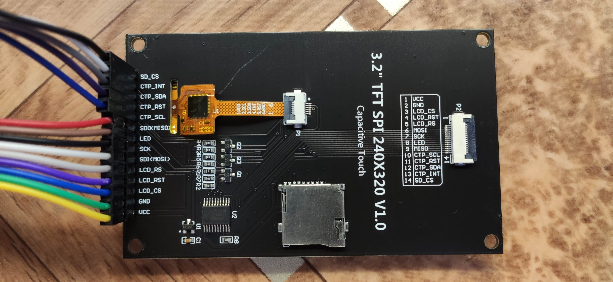
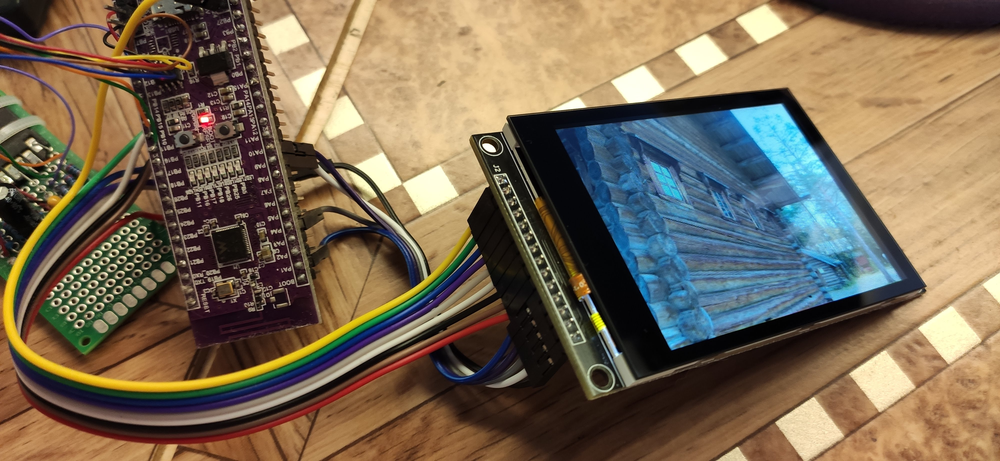

для контакта линии DC (дата/команда), применяется в 4-х проводном интерфейсе 4-Spi

ставим библиотеку libgpiod-dev 

$ sudo apt install libgpiod-dev

подробние 

[Работа с GPIO в Linux](https://devdotnet.org/post/rabota-s-gpio-v-linux-chast-6-biblioteka-libgpiod/)

[libgpiod doc](https://libgpiod.readthedocs.io/en/latest/index.html)

включаем spi1
~~~
orangepi-config
~~~
Выберите System -> Hardware.

поставить галочку

spi1-cs0-cs1-spidev

это добавит в файл /boot/orangepiEnv.txt строку

overlays=spi1-cs0-cs1-spidev

после перезагрузки

~~~
root@orangepizero2w:# ls /dev/spi*
появиться что что то типа
/dev/spidev1.0  /dev/spidev1.1
~~~

посмотрим куда контакты смотрят
~~~
root@orangepizero2w:~# cat /sys/kernel/debug/pinctrl/300b000.pinctrl/pinmux-pins | grep -E "spi1"
появиться что что то типа
pin 229 (PH5): device 5011000.spi function spi1 group PH5
pin 230 (PH6): device 5011000.spi function spi1 group PH6
pin 231 (PH7): device 5011000.spi function spi1 group PH7
pin 232 (PH8): device 5011000.spi function spi1 group PH8
pin 233 (PH9): device 5011000.spi function spi1 group PH9
~~~

тогда, соеденить по схеме:
~~~

-------         ------
Or2w            LCD 
-------         ------
5v    4         1  VCC
gnd   6         2  GND

PH05 24 (cs0)   3  CS   выбор чипа
PI03 40         4  RST  сброс (reset)
PI04 38         5  DC(RS)  комманда/данные
PH07 19 (mosi)  7  SDI  данные
PH06 23 (clk)   8  SCK  синхросигнал
PH08 21 (miso)
PH09 28 (cs1)
3v3  17         9  LED (подсветка)
-------         ------
Or2w            LCD   
-------         ------
~~~

3.2 TFT 240x320 MSP3223

Дисплей
фото 1 

фото 2

